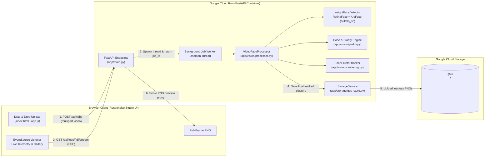
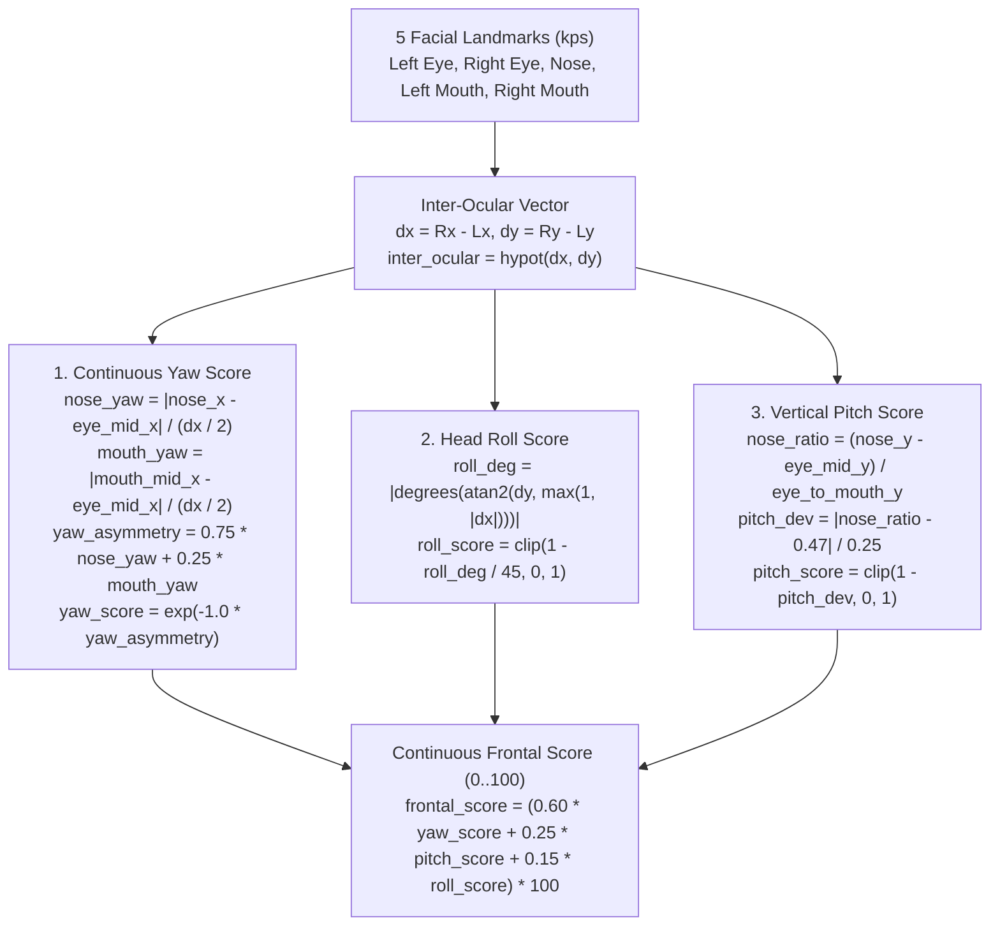

# Video Face Grab — System Architecture & Technical Deep Dive

**Video Face Grab** is a streaming computer-vision web application built with **FastAPI**, **OpenCV**, **InsightFace (RetinaFace + ArcFace ONNX)**, and **Google Cloud Storage (GCS)**, designed to run statelessly on **Google Cloud Run**.

Given an uploaded video file, the system scans frames at a configurable rate, detects every discernable human face/head (including individuals only ever seen in side-profile), clusters sightings by 512-dimensional facial identity embeddings so each person is represented exactly once, continuously upgrades each person's candidate frame whenever a more frontal, clearer shot appears, and exports lossless `.png` files of both the **full video frame** and **padded face crop** to a dedicated GCS folder (`gs://<bucket>/<video-stem>-<unique-number-suffix>/`).

---

## 1. High-Level Architecture



---

## 2. Repository Directory Structure

```text
video-face-grab/
├── app/
│   ├── __init__.py
│   ├── config.py               # Pydantic Settings (env vars & pipeline thresholds)
│   ├── main.py                 # FastAPI routes, SSE event generator, background job worker
│   ├── static/
│   │   ├── index.html          # Studio UI markup + <dialog> full-frame inspector
│   │   ├── styles.css          # Dark-mode responsive layout & flash animations
│   │   └── app.js              # Upload handler, EventSource consumer, DOM reconciliation
│   ├── storage/
│   │   ├── __init__.py
│   │   └── gcs_store.py        # Folder naming, PNG encoding, GCS upload & local fallback
│   └── vision/
│       ├── __init__.py
│       ├── processor.py        # Frame sampling loop, detector wrapper, SSE event emitter
│       ├── quality.py          # 5-landmark 3D pose filter & composite clarity scoring
│       └── clustering.py       # 512-D cosine clustering, best-frame tracking & consolidation
├── tests/
│   ├── test_quality_and_clustering.py  # Unit tests for sharpness, pose filter & clustering
│   └── test_api_and_storage.py         # Integration tests for GCS storage & FastAPI SSE stream
├── Dockerfile                  # Python 3.11-slim image with pre-warmed ONNX weights
├── deploy_cloud_run.sh         # One-command Cloud Build + Cloud Run deployment script
├── requirements.txt            # Pinned production & test dependencies
└── pyproject.toml              # Pytest configuration
```

---

## 3. End-to-End Processing Pipeline

### Step 1: Streaming Video Upload & Run Folder Allocation
1. The browser submits a video file (`.mp4`, `.mov`, `.webm`, `.mkv`, `.avi`, `.m4v`) via `POST /api/jobs` in `app/main.py`.
2. The server validates the file extension and streams chunks to a temporary file under `tmp_uploads/` while enforcing `MAX_UPLOAD_MB` (default `500 MB`).
3. `generate_run_folder_name(filename)` in `app/storage/gcs_store.py` sanitizes the video stem and appends a 10-digit unique suffix (6-digit UTC timestamp component + 4-digit random hex decimal), producing a collision-free prefix such as:
   ```text
   interview-clip-8492014829
   ```
4. A `JobRecord` is registered in memory and a background daemon thread starts `VideoFaceProcessor.process_video()`.

---

### Step 2: Stride-Based Frame Sampling
`VideoFaceProcessor` (`app/vision/processor.py`) opens the video with OpenCV (`cv2.VideoCapture`) and reads its native frame rate ($FPS_{\text{native}}$) and total frame count.
- Given `FRAME_SAMPLE_FPS` (default `3.0` frames/sec), the frame stride is:
  $$\text{stride} = \max\left(1, \text{round}\left(\frac{FPS_{\text{native}}}{\text{sample\_fps}}\right)\right)$$
- For a standard 30 FPS video, every 10th frame (`0.33s` interval) is decoded and passed to the face detector, reducing redundant computation by 90% while guaranteeing multiple sightings of any person on screen for $\ge 1\text{ second}$.

---

### Step 3: Face Detection & 512-D Embedding Extraction
Each sampled BGR frame is analyzed by `InsightFaceDetector` (`app/vision/processor.py`), which wraps the InsightFace `buffalo_sc` ONNX model pack running on `CPUExecutionProvider`:
1. **Detection (RetinaFace)**: Outputs bounding boxes $[x_1, y_1, x_2, y_2]$, detection confidence (`det_score` $\in [0, 1]$), and 5 facial keypoints (`kps`):
   - `kps[0]`: Left eye center (from viewer's perspective)
   - `kps[1]`: Right eye center
   - `kps[2]`: Nose tip
   - `kps[3]`: Left mouth corner
   - `kps[4]`: Right mouth corner
2. **Recognition (ArcFace)**: Extracts a 512-dimensional L2-normalized identity embedding vector ($\mathbf{e} \in \mathbb{R}^{512}$, $\|\mathbf{e}\|_2 = 1$).

#### Pre-Filter Guards
Before scoring pose or clustering, a candidate detection is immediately discarded if:
- `det_score < MIN_FACE_CONFIDENCE` (default `0.65`), or
- $\min(\text{width}, \text{height}) < \text{MIN\_FACE\_SIZE\_PX}$ (default `44 px`).

---

### Step 4: Continuous 3D Frontal Pose Scoring (`assess_frontal_pose`)
To ensure **every person in the video is captured** (even someone only ever seen in profile) while still guaranteeing that each person's **most frontal, square-to-the-camera shot** wins when multiple sightings exist, `assess_frontal_pose()` in `app/vision/quality.py` computes a continuous `frontal_score` (`0..100`) from the 5 keypoints:



1. **Horizontal Yaw Asymmetry (`yaw_asymmetry`) & Exponential Decay**:
   Measures how far off-center the nose tip and mouth midpoint sit relative to the midpoint between the eyes, normalized by the half horizontal eye span:
   $$\text{yaw\_asymmetry} = 0.75 \cdot \frac{|x_{\text{nose}} - x_{\text{eye\_mid}}|}{d_{\text{eyes},x} / 2} + 0.25 \cdot \frac{|x_{\text{mouth\_mid}} - x_{\text{eye\_mid}}|}{d_{\text{eyes},x} / 2}$$
   $$\text{yaw\_score} = \exp(-1.0 \cdot \text{yaw\_asymmetry})$$
   - `0.00` (Square with camera): `yaw_score = 1.00` (Best score).
   - `0.25–0.38` (Slight turn): `yaw_score ≈ 0.68–0.78`.
   - `1.50–3.00+` (Side profile): `yaw_score ≈ 0.05–0.22` (Worst score, but still retained so profile-only individuals are captured).

2. **Head Roll Tilt (`roll_degrees`)**:
   $$\text{roll\_deg} = \left|\text{degrees}(\text{atan2}(y_{R} - y_{L}, \max(1, |x_{R} - x_{L}|)))\right|$$

3. **Vertical Pitch Ratio (`pitch_deviation`)**:
   When a person looks straight ahead, the vertical ratio of the nose tip between the eye midpoint and mouth midpoint is approximately `0.47`:
   $$\text{nose\_ratio} = \frac{y_{\text{nose}} - y_{\text{eye\_mid}}}{y_{\text{mouth\_mid}} - y_{\text{eye\_mid}}}$$
   Looking downward (`nose_ratio >= 0.60`) or upward (`nose_ratio < 0.36`) increases `pitch_deviation` and lowers `pitch_score`.

4. **Combined Frontal Score (`0..100`)**:
   $$\text{frontal\_score} = \left(0.60 \cdot \text{yaw\_score} + 0.25 \cdot \text{pitch\_score} + 0.15 \cdot \text{roll\_score}\right) \times 100$$

---

### Step 5: Composite Clarity Scoring (`compute_composite_quality`)
Every sighting is assigned a `composite_score` $\in [0, 100]$ in `app/vision/quality.py` with **Frontal Pose weighted highest (`45%`)** so that square-to-the-camera shots always beat profile or downward-pitched shots of the same person:

$$\text{Composite Clarity} = 0.45 \cdot S_{\text{frontal}} + 0.30 \cdot S_{\text{sharpness}} + 0.15 \cdot S_{\text{confidence}} + 0.10 \cdot S_{\text{size}}$$

| Component | Weight | Calculation |
| :--- | :---: | :--- |
| **Frontal Pose ($S_{\text{frontal}}$)** | `45%` | Continuous 3D yaw, pitch, and roll score from `assess_frontal_pose()` (`100` = dead-center square to camera; lowest = side profile). |
| **Sharpness ($S_{\text{sharpness}}$)** | `30%` | Resizes the tightly cropped face to $128 \times 128$ grayscale, applies a $3 \times 3$ Laplacian filter (`cv2.Laplacian`), and maps pixel variance to $[0, 100]$. |
| **Detection Confidence ($S_{\text{confidence}}$)** | `15%` | RetinaFace detection probability scaled to $[0, 100]$. |
| **Relative Frame Size ($S_{\text{size}}$)** | `10%` | Ratio of face bounding-box area to total video frame area; reaches `100` when the face occupies $\ge 6\%$ of the frame. |

---

### Step 6: Identity Clustering & Post-Processing Consolidation
`FaceClusterTracker` (`app/vision/clustering.py`) maintains a list of `IdentityCluster` objects across the video:

1. **Dual-Anchor Cosine Matching**:
   Each cluster stores two L2-normalized 512-D embeddings:
   - `centroid_embedding`: Running mean of all sightings assigned to that cluster.
   - `best_embedding`: Embedding from the single highest-clarity frame (`best_quality.composite_score`) seen so far for that cluster.
   
   When a new face embedding $\mathbf{e}$ arrives, its similarity to cluster $C_i$ is:
   $$\text{sim}(\mathbf{e}, C_i) = \max\left(\mathbf{e} \cdot C_i.\text{centroid\_embedding},\; \mathbf{e} \cdot C_i.\text{best\_embedding}\right)$$
   If the highest similarity across existing clusters is $\ge \text{SIMILARITY\_THRESHOLD}$ (default `0.40`), the sighting is assigned to that cluster; otherwise, a new `IdentityCluster` is created.

2. **Best-Frame Replacement**:
   Whenever a matched sighting's `composite_score` exceeds the cluster's current `best_quality.composite_score`:
   - `best_frame_bgr` (the uncropped full video frame),
   - `best_crop_bgr` (the $35\%$-padded portrait crop),
   - `best_embedding`, and
   - `best_frame_index` / `best_timestamp_sec`
   are atomically replaced, and a `face_upgraded` SSE event is emitted to the browser.

3. **End-of-Video Cluster Consolidation (`_consolidate_clusters`)**:
   Sometimes a person first appears in a transitional or marginal pose that seeds a secondary cluster before upgrading into a clearer shot later in the scene. Before uploading to GCS, `get_verified_clusters()` runs an iterative pairwise consolidation pass:
   - If any two clusters have $\max(\text{centroid}\cdot\text{centroid}, \text{best}\cdot\text{best}, \text{centroid}\cdot\text{best}) \ge \text{SIMILARITY\_THRESHOLD}$, they are merged into the earlier cluster.
   - Their sightings counts are summed, their centroids are combined by weighted average and re-normalized, and the higher-clarity frame is retained.

---

### Step 7: Dual Lossless PNG Export to GCS
For every verified identity cluster, `StorageService.save_person_pngs()` (`app/storage/gcs_store.py`) encodes both images using `cv2.imencode(".png", ...)` and writes them to:
```text
gs://<GCS_BUCKET_NAME>/<video-stem>-<unique-suffix>/person_01_full_frame.png
gs://<GCS_BUCKET_NAME>/<video-stem>-<unique-suffix>/person_01_face_crop.png
```
If `GCS_BUCKET_NAME` is empty during local development, files are written with identical folder structure under `local_gcs_bucket/` with a path-traversal check (`target_local_dir.is_relative_to(base_local_dir)`).

---

## 4. Real-Time Server-Sent Events (SSE) Protocol

The browser connects to `GET /api/jobs/{job_id}/stream` via `EventSource`. The backend streams JSON events in real time:

| SSE Event Name | Trigger | Key Payload Fields | UI Action |
| :--- | :--- | :--- | :--- |
| `video_loaded` | Video file opened by OpenCV | `total_frames`, `native_fps`, `sample_stride`, `resolution`, `folder_name` | Initializes progress bar & frame counters |
| `frame_progress` | Every sampled frame (or stride) | `frame_index`, `total_frames`, `timestamp_sec`, `percent`, `discerned_faces_count` | Updates progress bar & elapsed video timestamp |
| `face_discovered` | New `IdentityCluster` created | `person_id`, `label`, `quality`, `preview_data_uri` (base64 JPEG) | Appends a new identity card to the live gallery |
| `face_upgraded` | Sighting beats cluster's best clarity score | `person_id`, `previous_best_score`, `quality`, `preview_data_uri` | Updates thumbnail & triggers `.flash-upgrade` highlight |
| `uploading_face` | Before uploading cluster PNGs to GCS | `person_id`, `label`, `folder_name` | Logs upload start in live telemetry feed |
| `face_saved` | Both PNGs uploaded to GCS | `person_id`, `full_frame_uri`, `face_crop_uri`, `full_frame_url`, `face_crop_url` | Enables **View Full Frame PNG** modal & download link |
| `job_complete` | All verified clusters uploaded | `total_people_saved`, `folder_name`, `bucket_name`, `people` | Prunes any consolidated temporary cards & marks job complete |
| `job_error` | Unhandled processing exception | `message` | Displays error state & re-enables upload form |

---

## 5. Gemini Enterprise (Gemini Agent) & ADK Architecture

In addition to the standalone Studio Web UI, the repository ships an **Agent Development Kit (ADK)** agent (`app/agent.py`, `app/tools.py`, `app/fast_api_app.py`) that exposes the exact same computer-vision pipeline inside **Gemini Enterprise (Gemini Agent)** over Vertex AI Agent Runtime (`:streamQuery`) and the Agent2Agent (`A2A`) protocol.

### 1. Video Attachment Interception (`VideoUploadInterceptorPlugin`)
When a user uploads a video via the paperclip in Gemini Enterprise (or ADK Web), `VideoUploadInterceptorPlugin` (`app/agent.py`) intercepts the incoming `video/*` `Part`:
- For `inline_data` attachments (up to `MAX_UPLOAD_MB` = `500 MB`), it saves the video bytes directly into the ADK `ArtifactService` (`<filename>.mp4`), records `session.state["latest_video_source"]`, and replaces the raw video bytes in `user_message.parts` with a lightweight text instruction (`[Attached Video Saved as Artifact: "<filename>.mp4" — call extract_forward_facing_faces(...)]`).
- For `file_data` (`gs://` URIs), it records the URI in `session.state["latest_video_source"]`.
- This prevents multi-megabyte video blobs from bloating the LLM token window while allowing `extract_forward_facing_faces` to read the exact video stream via OpenCV.

### 2. Three-Layer Inline Image Delivery (`extract_forward_facing_faces`)
Because `gs://video-face-grab-faces` enforces **Public Access Prevention**, `extract_forward_facing_faces` (`app/tools.py`) delivers each person's `person_XX_face_crop.png` and `person_XX_full_frame.png` inline through three complementary layers:
1. **ADK Session Artifacts**: Saves both PNGs into the session's `ArtifactService` (`await tool_context.save_artifact(...)`) with `mime_type="image/png"`, enabling native rich-media rendering in ADK & Gemini Enterprise.
2. **V4 Signed URLs (when credentials support signing)**: Generates temporary V4 Signed URLs (`StorageService.get_renderable_image_url`).
3. **Cloud Run `/api/storage/{folder_name}/{file_name}` Proxy Fallback**: Automatically falls back to `{PUBLIC_BASE_URL}/api/storage/{folder_name}/{file_name}`, which streams the PNG bytes from local cache or `gs://video-face-grab-faces` with `Cache-Control: public, max-age=86400` so Markdown `` and `` render inline in any browser.
